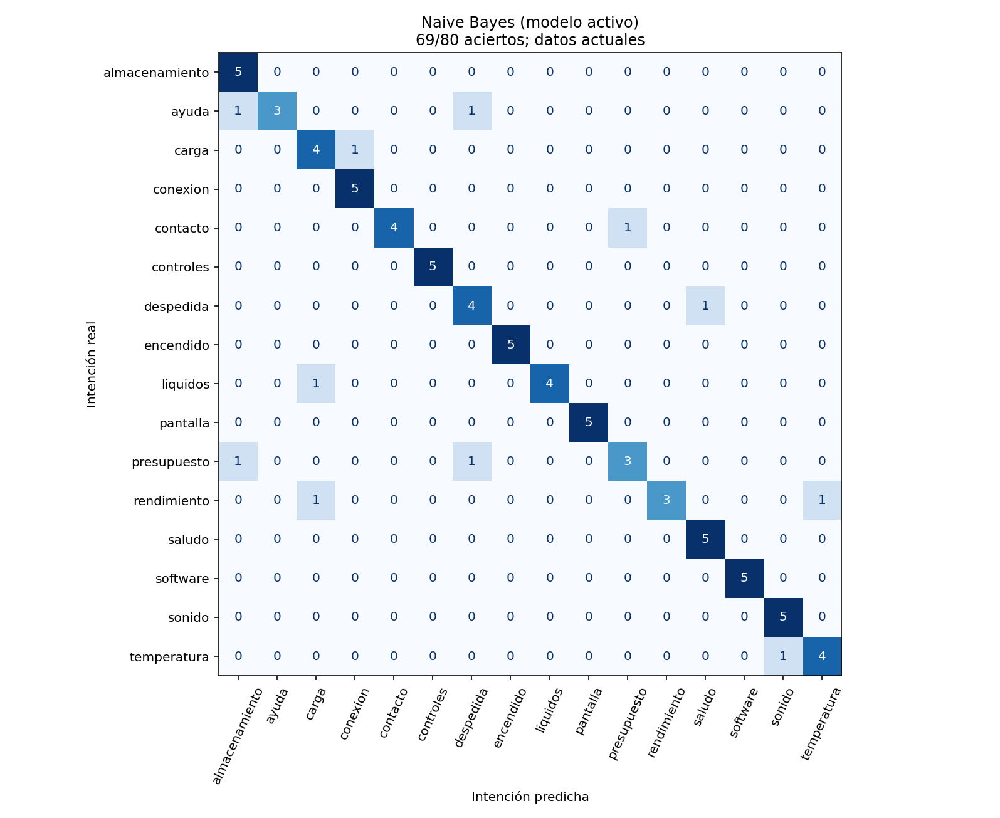
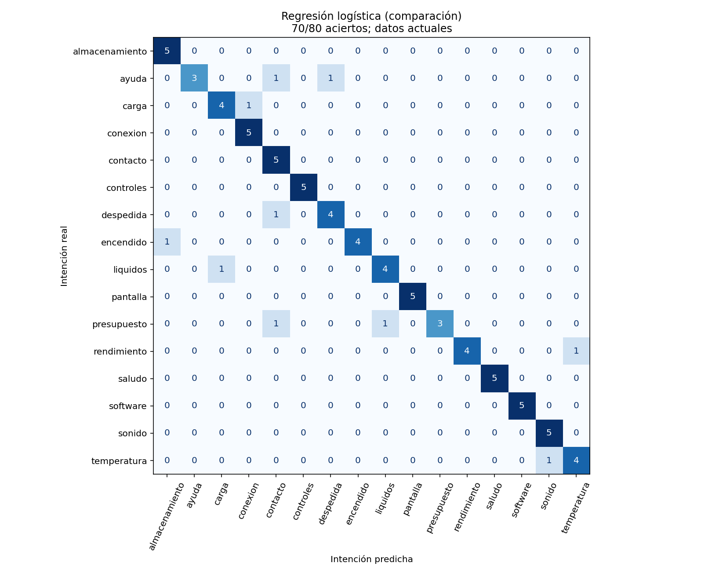
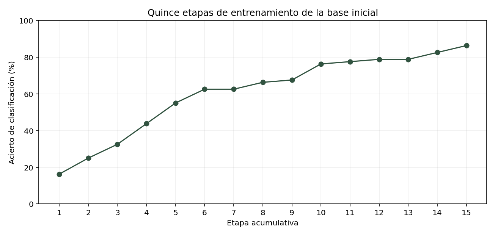

# YinYan Workshop: chatbot de soporte técnico informático

Fecha de corte: 18 de noviembre de 2026
Desarrollador principal: Sergio Adriel Muñoz Camarena
Docente: VICTOR MANUEL SANCHEZ SANCHEZ
Integrantes declarados: Sergio Adriel Muñoz Camarena

Siete páginas principales; portada y referencias separadas.

## 1. Problema, objetivo y organización

YinYan Workshop es un prototipo de soporte técnico informático, correspondiente a la opción B. Su objetivo es interpretar consultas sobre computadoras, celulares y consolas, formular preguntas breves y ofrecer comprobaciones externas o derivación al taller.

El alcance comprende fallas de encendido, carga, temperatura, rendimiento, conexión, pantalla, sonido, almacenamiento, software, controles y líquidos, además de saludo, despedida, ayuda, presupuesto y contacto. No confirma componentes dañados ni promete reparaciones, precios o citas.

Sergio Adriel Muñoz Camarena figura como desarrollador principal declarado: construye la plataforma para facilitar que sus compañeros aporten consultas, revisen etiquetas y entrenen el modelo. La colaboración propuesta contempla cuatro perfiles: dos de desarrollo y dos de aportación y revisión de datos. Esta distribución es una organización de la práctica; no acredita por sí sola participación histórica de cuatro personas.

La aplicación separa clasificación supervisada, gestor de diálogo e interfaz. El aprendizaje consiste en ajustar TF-IDF y el clasificador a ejemplos etiquetados; las respuestas provienen de plantillas. Ninguna API generativa sustituye la clasificación.

La evolución se presenta como quince etapas acumulativas sobre ejemplos sintéticos. Sus metadatos originales conservan su procedencia simulada. No son quince días de actividad humana acreditada; las aportaciones nuevas se identifican por separado con fechas reales del servidor.

El chat se ejecuta localmente. Node.js o Python escuchan en 127.0.0.1 y entregan la interfaz al navegador. GitHub comparte código y aportaciones; no es necesario un alojamiento público para cumplir la interfaz admitida por el profesor.

## 2. Dataset, intenciones y procedencia

La versión evaluada utiliza 240 ejemplos sintéticos de base y 0 ejemplos adicionales activos: 240 en total, distribuidos entre 16 intenciones. La evaluación contiene 80 consultas adicionales, separadas del ajuste. La tabla muestra los datos efectivos de esta ejecución.

Faltan 80 ejemplos pertinentes y diversos para llegar al mínimo de 20 por intención. El total general supera 200, pero ese total no sustituye el mínimo de cada categoría.

Las etiquetas representan necesidades comunicativas distintas; el equipo es una entidad del contexto, no una clase adicional. Su significado y acción se describen en docs/dominio-e-intenciones.md. Los ejemplos están en JSON y las consultas de evaluación en CSV.

La base y sus quince etapas se prepararon con asistencia generativa. Algunas entradas contienen faltas, abreviaturas y acentos omitidos para representar redacciones de práctica; las respuestas mantienen buena ortografía. La revisión humana de pertinencia y diversidad debe documentarse antes de presentar el corpus como validado por el equipo.

Los archivos de data/team/ contienen las aportaciones nuevas por autor. El experimento cuenta únicamente ejemplos etiquetados activos, conserva la procedencia sintética de la base y comprueba duplicados normalizados y etiquetas contradictorias. No utiliza las respuestas del propio bot como etiquetas verdaderas.

| Intención | Entrenamiento | Evaluación |
| --- | ---: | ---: |
| almacenamiento | 15 | 5 |
| ayuda | 15 | 5 |
| carga | 15 | 5 |
| conexion | 15 | 5 |
| contacto | 15 | 5 |
| controles | 15 | 5 |
| despedida | 15 | 5 |
| encendido | 15 | 5 |
| liquidos | 15 | 5 |
| pantalla | 15 | 5 |
| presupuesto | 15 | 5 |
| rendimiento | 15 | 5 |
| saludo | 15 | 5 |
| software | 15 | 5 |
| sonido | 15 | 5 |
| temperatura | 15 | 5 |

## 3. Preparación de texto y entrenamiento

Se convierte a minúsculas, se aplica Unicode NFD, se retiran diacríticos y se tokeniza con [a-z0-9]+. Se elimina puntuación y una lista breve de palabras vacías, conservando «no». Un diccionario explícito ofrece lematización ligera de flexiones frecuentes; no es un analizador morfológico completo.

TF-IDF representa unigramas y bigramas, con frecuencia sublineal, IDF suavizado y normalización L2. El vocabulario y el IDF se aprenden exclusivamente con cada partición de entrenamiento. Python y JavaScript comparten las decisiones de preparación e inferencia, verificadas mediante pruebas de paridad.

Se entrenan Multinomial Naive Bayes (alpha=0.25) y regresión logística (C=8, max_iter=2000) con los mismos ejemplos y representación. Se comparan con cinco pliegues estratificados, mezcla y semilla 42. La selección utiliza F1 macro promedio y el vectorizador se vuelve a ajustar dentro de cada pliegue.

Naive Bayes: F1 macro 0.4172 ± 0.0755; Regresión logística: F1 macro 0.4562 ± 0.0566. El ganador de la comparación actual por validación es Regresión logística. La aplicación conserva Naive Bayes, el método fijado para la práctica acumulativa. Ganador de validación y modelo desplegado se declaran por separado; la integración del candidato ganador queda pendiente si difiere del modelo activo.

La elección por validación no consulta el resultado del conjunto de evaluación. Sin embargo, ese conjunto de 80 mensajes ya fue observado durante el desarrollo del proyecto. Sus cifras actuales son de evaluación de desarrollo; para una afirmación final independiente hace falta reservar una prueba nueva y no ajustarse a sus errores.

La curva de la base va de 16 ejemplos y 13/80 aciertos en la etapa inicial a 240 ejemplos y 69/80 en la etapa 15. Cada etapa ajusta un modelo real con los ejemplos acumulados; no se agregan errores aleatorios ni se fija un porcentaje de éxito.

## 4. Resultados de la versión actual

Las cuatro métricas se calculan sobre la categoría más probable de cada consulta: accuracy, precision macro, recall macro y F1 macro. Los promedios macro asignan el mismo peso a cada intención. La tabla compara ambos algoritmos ajustados con el corpus actual.

El modelo activo es Naive Bayes; el ganador por F1 macro de validación es Regresión logística. El porcentaje de esta tabla mide clasificación, no calidad de reparación ni probabilidad de diagnóstico físico correcto.

El modelo activo acierta 69/80 etiquetas. Su F1 macro de validación (41.72%) es mucho menor que el F1 del conjunto de evaluación (86.00%). La menor cantidad de entrenamiento por pliegue y diferencias de dificultad o estilo entre particiones sintéticas pueden contribuir a la brecha; esta observación no demuestra su causa. Se necesita una prueba nueva de origen independiente para valorar generalización.

Con confianza mínima 0.24, margen 0.045 y cobertura léxica 0.20, el modelo activo acepta directamente 29/80 consultas. Entre las aceptadas acierta 29. En el resto puede pedir aclaración. Cobertura de aceptación y accuracy global son medidas diferentes: se cuenta una categoría más probable incluso cuando se rechaza para conversar.

Las matrices usan etiqueta real en filas y predicción en columnas. Las celdas fuera de la diagonal muestran confusiones; sus imágenes originales y valores están disponibles en reports/ y en el notebook para ampliarlos. La variación de los resultados al agregar ejemplos no garantiza una mejora con usuarios reales.

| Modelo | Accuracy | Precision macro | Recall macro | F1 macro |
| --- | ---: | ---: | ---: | ---: |
| Naive Bayes | 86.25% | 88.11% | 86.25% | 86.00% |
| Regresión logística | 87.50% | 89.53% | 87.50% | 87.34% |

## 5. Diálogo, interfaz y colaboración local

El flujo recibe el mensaje, prepara el texto, clasifica la intención, consulta el estado, selecciona una respuesta y actualiza el contexto. El estado conserva dispositivo, falla, pregunta pendiente y respuestas previas. Una respuesta como «sí» completa la comprobación pendiente y modifica la orientación posterior.

El gestor sostiene al menos tres turnos relacionados. Pregunta datos faltantes, conserva el dispositivo cuando una frase técnica no se clasifica y distingue un reinicio del equipo de un parpadeo de pantalla mediante opciones guiadas. Tras intentos sin aclarar ofrece contacto, evitando repetir indefinidamente el mismo mensaje.

Las frases desconocidas, ambiguas o con baja confianza provocan aclaraciones o una explicación del alcance. Las opciones elegidas se registran como decisión del usuario; no se cuentan como aciertos del clasificador. Nueva consulta elimina el contexto. Las alertas de líquido o batería dañada priorizan detener el uso y acudir a revisión.

La interfaz se organiza en Chat, Consultas y Entrenar. En Consultas se revisa el texto completo y su categoría antes de aprobar un ejemplo. El botón de entrenamiento usa la base y los ejemplos activos; después se selecciona el modelo personalizado para probarlo. Consultar y entrenar son operaciones distintas.

Cada consulta y ejemplo se guarda en data/team/alumno-a/ o data/team/alumno-b/, con identificador, autor, fecha UTC asignada por el servidor y zona America/Mexico_City. La página muestra fecha y hora locales. Una revisión enlaza a su consulta con source_query_id; retirar un ejemplo añade un registro y conserva la conversación.

Al iniciar un turno, recibir-aportes.cmd ejecuta pull. Al terminar, subir-aportes.cmd confirma data/team/ y hace push. El compañero recibe las fechas originales. El código y la bitácora viajan por Git; los modelos personales quedan en data/local/ y se reentrenan en cada computadora. El selector A/B identifica aportaciones, pero no autentica usuarios.

## 6. Pruebas funcionales y errores observados

Las pruebas de tests/ comprueban contexto, reinicio, aclaraciones, paridad, persistencia y servidores. El registro reports/current-dialogue-results.json contiene 7/7 casos funcionales aprobados con el modelo actual, transcripciones de varios turnos y seis consultas de sondeo nuevas respecto al entrenamiento. Este archivo se distingue de la evidencia del experimento anterior. En la revisión del 18 de noviembre de 2026 pasaron las 69 pruebas automáticas del proyecto. Las capturas y comprobaciones Chrome guardadas anteriormente son evidencia histórica; no se presentan como una ejecución nueva en esta fecha.

Las comprobaciones distinguen pruebas aisladas del gestor con clasificación inyectada de pruebas con un modelo real. Se cubren paráfrasis, mensajes nuevos, tres turnos, ambigüedad, consultas fuera del dominio, recuperación de consultas y reinicio del contexto.

Los tres casos siguientes son errores observados de Naive Bayes con el corpus actual. No son fallas inventadas para aparentar trabajo humano. Las interpretaciones ayudan a discutir cobertura léxica y contexto; no se reutilizan estas frases como ejemplos de entrenamiento para mejorar artificialmente la misma prueba.

### Error 1 · Naive Bayes · evaluación actual

Mensaje: «Hasta otra ocasión, taller».

Etiqueta esperada: despedida; predicción: saludo. Un cierre indirecto sin fórmulas habituales puede carecer de las señales léxicas aprendidas. Resultado observado: saludo; etiqueta esperada: despedida. Si la confianza es insuficiente, el gestor pide aclaración; una etiqueta incorrecta no implica que siempre se haya mostrado una orientación incorrecta.

### Error 2 · Naive Bayes · evaluación actual

Mensaje: «¿Qué consultas de soporte admites?».

Etiqueta esperada: ayuda; predicción: almacenamiento. Las peticiones generales y la cortesía comparten palabras; la intención pragmática depende de la frase completa. Resultado observado: almacenamiento; etiqueta esperada: ayuda. Si la confianza es insuficiente, el gestor pide aclaración; una etiqueta incorrecta no implica que siempre se haya mostrado una orientación incorrecta.

### Error 3 · Naive Bayes · evaluación actual

Mensaje: «Mi portátil pierde toda la autonomía al quitar el adaptador».

Etiqueta esperada: carga; predicción: conexion. La dependencia del cable puede expresarse sin mencionar batería o cargador. Resultado observado: conexion; etiqueta esperada: carga. Si la confianza es insuficiente, el gestor pide aclaración; una etiqueta incorrecta no implica que siempre se haya mostrado una orientación incorrecta.

## 7. Conclusiones, pendientes y reproducción

El prototipo integra un clasificador supervisado propio, un proceso de preparación reproducible, contexto conversacional y una interfaz local que permite revisión humana y entrenamiento colaborativo. La comparación actual de dos algoritmos y sus métricas permite explicar sus diferencias sin confundirlas con las de versiones anteriores.

Faltan 80 ejemplos pertinentes y diversos para llegar al mínimo de 20 por intención. El total general supera 200, pero ese total no sustituye el mínimo de cada categoría. Se necesita además completar los datos reales del equipo, documentar la revisión humana del corpus, entregar la URL del repositorio y preparar la defensa de todos los integrantes. La existencia del software no acredita quién participó ni sustituye la demostración en vivo.

Los resultados provienen de datos pequeños y sintéticos. Persisten límites ante jerga, negación compleja, paráfrasis poco cubiertas y dos fallas simultáneas. La confianza no está calibrada para afirmar certeza de diagnóstico. La evaluación ya consultada debe complementarse con una prueba nueva reservada para la entrega final.

Para reproducir: instalar requirements-lock.txt; iniciar.cmd abre el servidor. python -m src.current_experiment compara los modelos actuales; python -m src.simulation --check verifica las etapas. El entrenamiento personalizado usa python -m src.simulation --custom o el botón de la página. generar-reporte.cmd regenera este documento a partir del experimento actual.

El notebook notebooks/experimentacion.ipynb registra 12/12 celdas de código ejecutadas, 4 salidas PNG y 0 errores de ejecución. Su contenido, dependencias y resultados deben acompañar el mismo corpus de esta revisión. Las cifras no afirman una nueva prueba en Chrome.

## Referencias

Consigna del curso. Proyecto Final I: Chatbot Inteligente mediante Aprendizaje Automático. Documento proporcionado por el usuario; entrega indicada el 4 de diciembre.

scikit-learn. User Guide: extracción de características textuales, pipelines, validación cruzada y métricas de clasificación. https://scikit-learn.org/stable/user_guide.html

Pedregosa, F. et al. (2011). Scikit-learn: Machine Learning in Python. Journal of Machine Learning Research, 12, 2825–2830. https://jmlr.org/papers/v12/pedregosa11a.html

Python Software Foundation. Documentación de Python y http.server. https://docs.python.org/3/library/http.server.html

YinYan Workshop. Perfil de contacto proporcionado: https://www.instagram.com/yinyan_workshop/. No se usó como fuente de consultas de entrenamiento.

Fuentes: data/simulation.json y data/team/; src/current_experiment.py y src/preprocessing.py; web/simulation/, web/ml.js y web/dialogue.js; reports/current-experiment.json y sus figuras; tests/; notebooks/experimentacion.ipynb. La aplicación activa conserva Naive Bayes.
